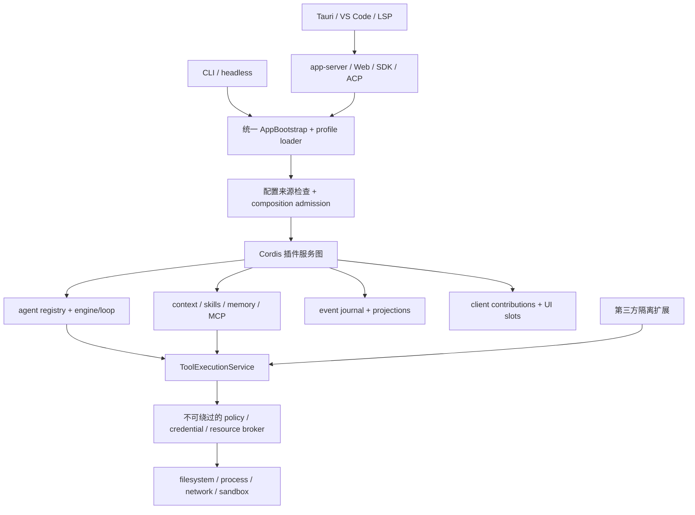

# DeepCode 全面 Harness 化改造方案

> 状态：**方案已批准进入实施；H01–H04 基线已实现并完成本机验证**。逐包证据见 [实施进度](HARNESS_IMPLEMENTATION_PROGRESS.md)。
>
> 日期：2026-11-17（Asia/Shanghai）
>
> DeepCode 基线：`main@3421a3c77a4955d428b2bc9b5169c128b85c1279`，0.4.0 代码。
>
> 调研基线：`deepseek-ai/deepseek-harness@39163dd30f703a79079e2d2446545cff3c453738`，0.2.2-rc.3。
>
> 决策：[ADR 0003](adr/0003-plugin-composed-harness.md)；契约：[Harness runtime v2](design/harness-runtime-v2.md)；证据：[源码研究](research/deepseek-harness-architecture-2026-11.md)。

## 1. 要改成什么

将 DeepCode 从“统一 runtime 加一组扩展功能”改成**由插件组成的 coding harness 产品**：agent loop、模型提供者、工具、上下文策略、会话存储、任务、客户端功能，均通过有类型的服务接口注册，由 profile 与 bundle 声明组合，并具有明确的依赖、作用域、卸载和失败恢复语义。

采用 DeepSeek Harness 的 Cordis 组合模式、服务接口/实现/消费者分离、事件会话、统一启动入口、客户端插件图和可检查配置。DeepCode 保留品牌、已有用户资产、Tauri、CLI/IDE 兼容和更严格的安全边界。**插件化覆盖所有产品领域；安全根授权不能被普通插件或配置取消。**

旧 [DSH 采纳方案](DSH_ADOPTION_PLAN.md) 在“只补若干功能”的产品前提下拒绝 Cordis 重写。本次用户明确要求完整改造成 Harness 模式，前提已经改变：本提案重新作出架构决策，并覆盖旧方案的架构拒绝项。之前已完成的 spill、guard、shell、工具展示等继续迁移和复用，不重做一遍。

完成后的三个可观察例子：

1. 新增模型、工具或上下文策略，只新增插件并加入 profile；不修改 `agent.ts`、CLI REPL、server composition 三处。
2. CLI、Web、Tauri、VS Code 在同一 profile 下得到相同模型能力、工具政策、自动压缩和任务生命周期；呈现差异由客户端插件负责。
3. 用户能查看有效插件树、配置来源、能力和版本；禁用插件后，其工具、UI、监听器和资源都消失。缺失安全依赖时运行失败，不能自动退回无门禁执行。

### 1.1 范围和完成边界

“完整”指核心、现有功能和所有现有客户端全部迁到同一种运行模式，并提供可用的 Web、SDK/ACP 接入及插件开发闭环；不是只给旧 `runAgent()` 包一层 `apply()`。

上游 browser/computer use、远程执行、workflow、goal/team 等也纳入领域规划与扩展波次，但不把所有上游实验插件的功能数量作为核心重构验收。每个领域必须有去向；没有实测的能力明确保持 experimental。不得声称与 dsh 插件二进制、会话文件、wire protocol 或所有模型完全兼容。

H00 阶段只提交设计；用户随后授权先实施 H01/H02，代码、测试、固定依赖和打包原型已加入工作区。未迁移用户数据或发布软件；后续实现按第 9 节推进。

## 2. 文档阅读顺序与权威关系

| 文档                                                                                              | 作用                                                         |
| ------------------------------------------------------------------------------------------------- | ------------------------------------------------------------ |
| 本文                                                                                              | 产品目标、全领域差距、迁移路线、验收和工作量                 |
| [ADR 0003](adr/0003-plugin-composed-harness.md)                                                   | 为什么采用 Cordis、为何保留安全内核/Tauri、依赖策略与回滚    |
| [Harness runtime v2](design/harness-runtime-v2.md)                                                | 服务契约、作用域、执行管线、日志/协议/配置和迁移细节         |
| [2026-11 源码研究](research/deepseek-harness-architecture-2026-11.md)                             | 固定 commit 的代码事实、上游限制与可采用机制                 |
| [Codex alignment plan](CODEX_ALIGNMENT_PLAN.md)                                                   | 上一轮架构历史；Thread/Turn/Item、薄客户端和安全原则继续有效 |
| [ADR 0001](adr/0001-desktop-runtime-sidecar.md)、[ADR 0002](adr/0002-multi-model-agent-engine.md) | Tauri sidecar、多模型及 SDK engine 的保留边界                |
| [DSH 采纳方案](DSH_ADOPTION_PLAN.md)、[旧调研](research/deepseek-harness.md)                      | 早期小范围采纳的历史依据；不是最新完整架构或完成度报告       |

本文与新 ADR 已成为下一轮架构路线事实源；已实现范围以 [实施进度](HARNESS_IMPLEMENTATION_PROGRESS.md) 为准；当前可用行为以源码、用户文档及实际验证为准。设计中的新增包名、配置和命令均为**拟定接口**，不是已可运行指令。

## 3. 最新代码对比：已有基础与真实差距

### 3.1 拉取与研究范围

开始时工作区干净，位于 `docs/v0.3.0-report@04c09e8`。先执行该分支的 `git pull --ff-only`，结果已同步；随后保留原分支，切到 `main` 并快进拉取到上述基线。文档工作分支为 `codex/harness-transformation-plan`。

上游源码克隆至仓库之外进行静态阅读，未执行其安装/构建脚本。研究覆盖真实入口、Cordis、agent/session/tools、持久化、插件管理、client graph、desktop、SDK/ACP、安全和测试代码；不以 README 宣传或目录数量判断成熟度。上述为 H00 的静态研究过程；H01/H02 后续安装产物及产品全量测试见实施进度，不以历史 CI 数字替代当前验证。

### 3.2 架构对照

| 领域   | Harness 源码模式                                     | DeepCode 当前事实                                                    | 目标处理                                                     |
| ------ | ---------------------------------------------------- | -------------------------------------------------------------------- | ------------------------------------------------------------ |
| 组合   | Cordis Context/Fiber、服务注入、可逆注册             | `RuntimeHost` 固定组装；CLI 与 server 各自 composition               | 统一 `AppBootstrap`、scope 与 profile；旧 host 作迁移 facade |
| Agent  | registry 与 loop provider 分离；inbox/step/turn 事件 | `agent.ts` 大函数；`AgentEngine` 只有 native/claude-sdk              | loop、context、executor 解耦；保持每 turn 单一 loop owner    |
| 工具   | scope registry、executor seam、可撤销 registration   | 静态 `BUILTIN_TOOLS`，registry 缺卸载；多条执行路径                  | 动态 registry + 一个强制 ToolExecutionService                |
| 模型   | adapter registry、prepared call 与能力描述           | `ConfiguredProvider` 支持 DeepSeek/Kimi/GLM，目录为静态数据          | 保留 adapter，加注册、能力协商和请求快照                     |
| 会话   | append-only event log，模型历史与 UI 为 projection   | snapshot JSON + session-v1 message projection；legacy 双读单写已存在 | 一个新的版本化事件事实源；旧格式只读适配                     |
| 上下文 | prompt sections、projection、压缩/剪枝等插件         | CLI 自动压缩，server 未启用；server 按 history offset 投影           | 独立 ContextCheckpoint，压缩不能截断 durable timeline        |
| 进程   | shell、subagent、后台资源有 owner/scope              | CLI shell 跨 turn；server 资源按 turn 关闭；TaskManager 为内存状态   | session/job/resource ownership 统一，持久元数据与活进程分开  |
| 插件   | host/client 双面包、bundle/profile、安装和激活事务   | manifest/hash trust、skills/MCP/hooks；`toolHandlers()` 返回空数组   | 第一方 runtime plugins + 隔离第三方 extension SDK            |
| 客户端 | Web client module graph、typed UI slots              | Desktop/IDE 已经用 app-server；CLI 仍自己组装 host                   | 全端复用 bootstrap/client SDK；Web 与 Tauri 共用 UI 图       |
| 传输   | Web RPC、SDK JSON-RPC、ACP 分别适配                  | protocol v1 + stdio + Tauri bridge 已有                              | 保留 v1；新增 capability/v2 adapter，绝不混同 wire           |
| 桌面   | Electron + profile runner + bundled runtime          | Tauri + Node sidecar 已有                                            | 保留 Tauri，复用新的 Web UI 与同版本 profile                 |
| 安全   | policy/executor/guard 可插件化，可信组合决定约束     | 强制 dispatcher 已有，但插件桥仍有缺口                               | 组合前校验 + root broker + OS isolation；普通插件只能收紧    |
| 分发   | upstream Node ≥24.9、pnpm 11、原生锁/Zstd            | Node 22、pnpm 9、现有包体和签名门禁                                  | 不隐式升级运行环境；先验证 Cordis 最小依赖闭包               |

### 3.3 不能重复报为未实现的能力

- `apps/desktop/src/lib/protocol-agent.ts`、Tauri `app_server.rs`、VS Code `protocol-runtime.ts`、LSP `handler.ts` 已经经 app-server 执行；renderer 持 key、IDE 直接绕过 `runAgent`、LSP 只删本地 id 是旧基线问题。
- `packages/protocol` 已有 Thread/Turn/Item、审批、中断、恢复及 review；不是新建协议项目。
- `SessionManager` 已有旧 core/desktop 格式兼容及 writer 约定；worktree 删除已保留分支并拒绝脏目录。
- `spill/`、`guard/`、`shell/`、`sessions/search.ts`、`tools/presentation.ts` 均有实现。
- file contract、ledger/provenance、`/combo`、cron calendar/filesystem trigger 与 ADR 0002 多模型不能在重写中遗失。
- 旧 DSH §1.7 的模型无关历史结果剪枝**尚未实现**；`compaction/index.ts` 仍是 LLM 摘要，不把 ledger 的 prune 当作上下文剪枝。

### 3.4 应先修复的插件安全缺口

以下记录 H00 基线的静态审查发现；H01 已用统一 executor 和真实隔离测试处理，当前行为及限制见 [实施进度](HARNESS_IMPLEMENTATION_PROGRESS.md#h01统一执行与安全边界)：

| 路径/符号                                                                                     | 当前事实                                            | 改造要求                                                                      |
| --------------------------------------------------------------------------------------------- | --------------------------------------------------- | ----------------------------------------------------------------------------- |
| `apps/cli/src/repl.ts:buildPluginCapabilities`、`headless.ts:buildPluginCapabilitiesHeadless` | 直接调用 Read/Write/Bash/WebFetch handler，仅传 cwd | 所有插件能力通过强制 executor，继承权限、contract、signal、sandbox、审计      |
| `plugins/runtime/subprocess.ts:start`                                                         | `process.env` 全量展开，仅清两个 DeepSeek key       | 环境 allowlist；Kimi/GLM/自定义 secret 不得继承；按显式 credential grant 访问 |
| 同上                                                                                          | 仅 `sandbox.enabled` 为真时包裹 OS sandbox          | 按有效 sandbox mode 统一解析；默认和 mode-only 配置一致，不可静默裸跑         |
| `apps/server/src/runtime-composition.ts:buildPluginCapabilityBridge`                          | 有 dispatcher，但不是完整 native/SDK 执行语义       | 合并 deadline、snapshot、ledger、spill、审批后路径复核与取消流程              |
| `PluginSubprocess` 关闭路径                                                                   | child kill 不等于完整进程树停止                     | 进程组 owner、drain、超时强杀和晚到事件拒绝                                   |

目录前缀未写全的 core 路径均在 `packages/core/src/`。不要把 TypeScript 类型、hash trust 或单独进程当成恶意插件隔离。

## 4. 目标架构与包边界



采用 Cordis 的实际 Context/Fiber 模型；`packages/kernel` 只封装依赖版本与 DeepCode 契约，不另造一个号称兼容 Cordis 的 DI 框架。第一方安全组件也可由内部插件注册，但启动器必须验证其实现身份和不可撤销约束；外部配置不能替换 root broker。

拟定目录（初期逻辑模块可同包，边界成立后再拆发布包）：

```text
packages/
  kernel/                  # Cordis adapter、scope、bootstrap、composition admission
  runtime-contracts/       # engine/tool/session/provider/jobs 的纯数据和服务契约
  extension-sdk/           # 第三方 manifest、声明式贡献和受限 RPC
  runtime-services/        # 第一方 agent/session/context/tool/job 默认实现
  runtime-security/        # root broker、政策、credential、resource supervisor
  plugins/                 # providers、tools、context、MCP、skills、review、governance
  bundles/                 # base-coding、interactive、headless、web、editor、sdk、acp
  client-sdk/              # transport + capability + projection/store，非 React
  client-web/              # React plugin host、typed slots、基础 UI
  protocol/                # 现有公共协议，兼容 adapter 与未来协商版本
  shared-ui/               # 继续仅跨端类型；不塞 React 实现
  core/                    # 兼容 facade，逐步收缩，最终只保留旧 public export adapter
apps/
  cli/  server/  desktop/  vscode/  lsp/  web/
```

实现拆目录时显式更新 `pnpm-workspace.yaml`（嵌套 plugins/bundles）、TS references、exports、发布清单和 release-gate；本轮不创建空包充进度。接口/实现/消费者要解耦，但不要求一个 seam 机械拆三个 npm 包。

### 4.1 Cordis 与上游复用策略

- 首选固定版本的 `@deepseek-ai/cordis` 及其兼容依赖；H02 验证实际 registry tarball、integrity、exports、Node 22、dispose 行为与 bundling。H02 已核验官方 4.1.0 tarball、完整性、Node22 和打包；registry 产物与研究 commit 存在差异，采用实际发布物并固定测试，见实施进度。
- 若发布物不可用或与审阅源码不符，选取上述固定 commit 的 `vendor/cordis` 及必要依赖做最小 vendor 镜像，保留 MIT/原版权、来源 manifest 与补丁清单。不能用普通 `cordis` 包静默代替 upstream fork。
- 不直接依赖整个 dsh CLI，不将 `dsh web` 藏在 DeepCode UI 后面；不整仓 fork。采用可审计的最小框架闭包和模式，按领域迁移现有实现。
- Node 22/pnpm 9 是当前门禁。Node 24、Zstd、原生跨进程锁、PTY 的引入必须单独 spike 和分发决策；H02 不通过则暂停新组合默认化，保留旧运行时，不偷偷放宽 runtime floor。

## 5. 全领域迁移清单

表中“完成”都指生产默认 profile 中生效、生命周期测试通过、所有已有消费者迁完，不能以新目录存在为依据。

| 领域/当前入口                                       | 目标插件或服务                                             | 保留/新增行为及完成条件                                                    |
| --------------------------------------------------- | ---------------------------------------------------------- | -------------------------------------------------------------------------- |
| `runtime/host.ts`、`agent.ts`                       | agent registry、native-loop、engine registry               | facade 迁移后删除客户端手工 composition；可替换 loop，单 owner             |
| `providers/*`、server `engines/claude-sdk.ts`       | provider-deepseek/kimi/glm、engine-claude-sdk              | capability 驱动参数；SDK 继续 experimental，私有 history 不混写            |
| `tools/*`、`harness/tool-dispatcher.ts`             | scoped tools、唯一 executor、文件/命令/网络 plugins        | 所有调用路径一致；tool presentation 保留；schema 与 executor 分离          |
| `config/*`、credentials                             | profile/settings/diagnostics + protected credential broker | 旧 JSON 可读、来源可查；project 不能扩大权限或把全局 key 发给新 endpoint   |
| `sessions/*`、server store                          | journal、legacy adapters、UI/model projections             | 单 writer，旧文件字节不变，可断电恢复；SDK mapping 保留                    |
| `compaction/`、memory、reminders、spill、guard      | prompt/context/compaction/pruning/spill/guard plugins      | model-visible 输入可追溯，server 与 CLI 同行为；剪枝保留 tool 配对         |
| `skills/*`、`/combo`、output styles、slash commands | skill provider registry、command/prompt contributions      | 同名优先级、可调用范围明确；distill 记录来源和用户修改                     |
| `mcp/*`、`mcp serve`                                | MCP manager、client/server bridge                          | workspace/session 生命周期、重连及超时；所有工具仍经 executor              |
| `hooks/*`、plugins                                  | hook adapter、isolated extension host、plugin manager      | 旧 manifest/Claude 风格资产读适配；hook 可拒绝，不能授权越界               |
| `tasks/`、sub-agents、Task 工具                     | jobs、subagent provider、task graph                        | durable job metadata、精确 run epoch、父子授权交集、容量/预算              |
| `shell/*`、Bash、后台任务                           | process service、shell plugin、job-owned resource          | session shell 跨 turn；interrupt 与后台脱离语义明确；策略收紧可撤销        |
| `cron/*`、launchd、trigger profile                  | scheduler/trigger plugins                                  | 时间、ICS、文件事件复用；去重、离线补跑规则、无人值守审批拒绝              |
| worktree、snapshots、review                         | workspace isolation、snapshot、review plugins              | 不删未合并分支；冲突安全 apply/revert；精确 file/item/turn 归属            |
| file contract、ledger、capabilities                 | governance plugins + protected enforcement                 | contract 的 shell/网络局限继续诚实披露；审计与实际执行绑定                 |
| voice、vision、keybindings、Vim                     | media/input/presentation plugins                           | 权限/平台检测、取消录音、输入附件引用；不把媒体凭证放前端                  |
| CLI/headless                                        | interactive/headless profiles、CLI client                  | 原 flags/slash/exit code/JSON/JSONL golden 不变；单次命令不强制驻 daemon   |
| desktop                                             | shared Web UI + Tauri carrier                              | onboarding/settings/thread/review 全迁；Node sidecar 随包、无 renderer key |
| VS Code/LSP                                         | editor profile、protocol client adapters                   | extension-host/webview 边界保持；LSP 只做真正编辑器桥接                    |
| 新 Web                                              | authenticated loopback host、client-web profile            | 同一 UI 图，重连/背压/多观察者；远端监听显式 opt-in                        |
| 新 SDK/ACP                                          | typed client SDK、独立 ACP adapter                         | 启动 canonical profile；版本握手；权限和 cancel 的无损映射                 |
| observability/replay                                | diagnostics/trace/recording plugins                        | 配置图、插件状态、trace、请求快照均可脱敏导出                              |
| 插件 UI/分发                                        | typed slots、catalog、安装激活事务                         | 开发工具和样例可从干净环境安装/卸载/升级；缺 UI 时 generic fallback        |

### 5.1 上游高级领域的明确去向

| 领域                                 | 本方案处置                                                   | 启用条件                                                                |
| ------------------------------------ | ------------------------------------------------------------ | ----------------------------------------------------------------------- |
| goal / team / Ralph continuation     | H12 加可选插件；goal 与 turn/task 分开；不把自动重试视作完成 | 总预算、阻塞状态、停止条件、durable ownership；不能自行无限续跑         |
| workflow / programmatic tool calling | H12 增 execution provider，经同一 broker                     | 有界解释/隔离执行、嵌套工具审批与取消；默认不执行任意不受限脚本         |
| PTY / terminal UI                    | H12 可选实现；现有 pipe shell 保留为默认                     | 原生依赖构建、进程组/resize/断连重附着及平台预算通过                    |
| remote filesystem/process sandbox    | H12 可选 execution-world provider                            | fs/process 指向同一世界，路径/凭证/网络不跨边界；本地策略不可被远端降级 |
| browser / computer use               | H12 单独能力插件，未验证不进默认 coding profile              | OS/browser 权限、数据边界、取消和实际动作审计；平台 E2E                 |
| 全量上游第三方插件兼容               | 不承诺；提供明确 adapter 与支持清单                          | 外部 host 插件需移植到 DeepCode 限权 API；不能直接当受限扩展加载        |

这些领域不能阻挡安全内核/已有功能迁移，但也不能在最终报告里被写成已经交付。完整架构验收与每个可选功能验收分别记录。

## 6. 产品与客户端改造

### 6.1 用户入口

保留 `deepcode`、`deepcode -p`、原 CLI 参数和 npm 包名；新增拟定 `--profile`、`profile inspect`、`plugin inspect`、`web`、`sdk`、`acp` 入口。CLI 的 `--profile` 指组合 profile；现有模型/provider profile 和 trigger profile 单独命名展示，不混用一个字段。

默认发货 `interactive`、`headless`、`desktop`、`editor`、`web`、`sdk`、`acp`，共享 `base-coding` bundle。不同 profile 只改变展示、交互和可用扩展，不隐式放宽权限。shell completions、help、schema、文档和版本诊断同步发布。

### 6.2 UI 信息结构

保留项目/线程/时间线/Changes 的用户模型，加入可检查的插件和运行时状态：

- **Composer**：能力驱动 model/effort、附件、Plan/Default、停止、下一安全边界输入；不展示不支持的 engine 操作。
- **Timeline**：消息、工具、审批、上下文压缩、计划、子任务、review 作为有版本 node；大输出按需取回。
- **Inspector**：Changes、Files、Jobs/Agents、Context、Runtime；Runtime 能查看 profile、插件图、来源和诊断。
- **Settings**：Models、Permissions、MCP、Skills、Plugins；显示修改影响的 scope、生效时机及需重启项。
- **Plugins**：inspect → 权限/版本差异 → install → activate；失败时解释停用或重启状态，不显示虚假“已启用”。

第一方 UI 通过 sidebar/composer/timeline/inspector/settings/command/status 等 typed slots 注册。第三方第一阶段仅允许声明式卡片和受控 action；任意 JS UI 必须进入独立不透明 origin 的 sandbox iframe 与限权 RPC。上游同源 iframe 不能当作隔离实现。

### 6.3 共享不等于共享 active writer

stdio profile 继续单客户端 owner。Web host 可有多个 observer，但同一 thread 只允许一个 turn writer；审批 owner、断连、抢占和重新授权由 host 判定。Tauri 仍可独立 sidecar，不能因为复用协议就声称多个 sidecar 可同时续写一个会话。跨进程 active attach 属于 H10 的显式 host ownership 功能。

## 7. 关键设计约束

详细接口见 [runtime v2](design/harness-runtime-v2.md)，以下约束不能在实现中省略。

1. **作用域和取消**：app → workspace → session → turn → invocation/resource；dispose 先停止接入，撤销 grant，取消 provider/approval/jobs，drain 执行，再移除服务和监听。完成状态不得早于副作用停止。
2. **安全组合**：mandatory 服务来自可信构建清单；所有 tools/MCP/hooks/plugin/workflow/SDK 走 broker。进程内任意 JS 天然有宿主权限，仅限随发行版审查的第一方代码。
3. **事件事实源**：durable journal 独立于 UI wire 和模型上下文；native 请求快照引用不可变事件范围、context checkpoint、插件图和模型能力。外部 SDK loop 仅记录 host 可观察事实和私有恢复引用，不承诺完整内部请求回放。
4. **执行结果不伪造**：崩溃可能发生在“工具完成、结果未持久化”之间，此时记录 unknown side effect，恢复时不自动重放写操作。日志不能赋予 shell exactly-once 副作用。
5. **配置可解释**：每个有效字段有来源、scope、信任、版本；权限按交集而非普通后层覆盖。插件 hot reload 在 turn 边界提交；active turn 固定 generation。
6. **兼容**：保留旧 CLI/protocol/user files 的读取；原地混写引擎和旧存储一律禁止。升级和回滚都不能恢复 renderer agent。
7. **模型边界**：DeepSeek/Kimi/GLM 的 continuation、reasoning、usage、价格和工具能力各由 adapter 表达；Claude SDK 自有 loop/压缩与 private session 继续独立。

## 8. 数据、配置与插件迁移

### 8.1 会话和用户资产

| 资产                                                   | 迁移策略                                                               | 降级结果                                         |
| ------------------------------------------------------ | ---------------------------------------------------------------------- | ------------------------------------------------ |
| legacy core/desktop JSONL、session-v1、thread snapshot | 类型探测 → 只读归一化 → 独立 v2 journal；保存源 hash/id 与缺失信息标记 | 旧程序仍可读原会话；看不到 v2 后续追加，明确告知 |
| SDK `engine.json`、私有 SDK session/mapping            | 保持原 engine binding；仅导入公共 timeline 投影和私有引用              | 关闭 SDK profile 后保留，不能转成 native 恢复    |
| snapshots、spill、attachments、review、ledger          | 建资源 manifest；验证关联、hash、workspace 权限；复制或受保护引用      | 不删原数据，不随插件卸载删除审计资产             |
| settings、permissions、MCP、skills、hooks              | 只读 compatibility loader → 有来源的有效配置；显式导出新配置           | 旧文件不被新 loader 静默改写                     |
| plugin manifest/trust                                  | 旧资产按兼容 adapter 加载；旧 trust 不授予新的 host-code 或 UI-JS 权限 | 旧插件仍可在旧 runtime 使用，隔离新安装目录      |
| cron/trigger、worktree、项目索引                       | 保留 id/path；调度 owner 迁移时先停旧 scheduler；不移动用户仓库        | 防双调度，停新 scheduler 后显式恢复旧 owner      |
| Keychain/环境变量                                      | credentialRef 继续后端解析，不导出实际 key                             | 原凭证不删除；插件安装不能扩大 secret 访问       |

迁移提供拟定 `migration inspect/dry-run/import/verify` 操作，输出源/目标、版本、丢失字段、字节/hash 和回滚指引。批量导入是可中断事务，单个会话 commit 后发布；不能对所有用户会话启动时自动批处理。磁盘空间不足、未来版本、损坏中段记录必须显式拒绝。

### 8.2 灰度与回滚

- 编译时保留 `legacy` 与 `harness-v2` 两种 runtime backend；它们不是新的 LLM engine。每个会话绑定 backend/generation/engine，禁止双写。
- 先 shadow 运行纯投影/配置解析，对比结果；**绝不把同一写工具在两个 backend 执行**。
- 以新建 thread 做 canary；导入旧线程产生有 lineage 的新 generation，不回写源。用户选择恢复到旧 backend 时打开旧线程或显式摘要 fork，说明 v2 续写不会自动倒灌。
- profile 激活使用 last-known-good generation。失败保留旧图和配置；已产生的外部副作用、install script 和模型费用不声称可回滚。
- 最终默认切换后至少保留两个正式发布周期的旧格式只读适配和明确的旧版安装指引；删除旧 runtime 必须在 H14 专项验收后进行。

## 9. 可执行 PR 路线

编号是工作包，允许在同边界内拆小 PR。没有开始实施的包均为 pending；用户已批准 H01/H02 实施，两者本机验收已完成。工作包状态、证据与平台边界统一记录在 [实施进度](HARNESS_IMPLEMENTATION_PROGRESS.md)。

| 包                            | 依赖                 | 主要改动与文件落点                                                              | 必须提供的验收证据                                                             |
| ----------------------------- | -------------------- | ------------------------------------------------------------------------------- | ------------------------------------------------------------------------------ |
| H00 方案                      | 无                   | 本文、研究、ADR、设计契约、入口指针                                             | 路径/链接/格式/docs:check；用户可独立阅读                                      |
| H01 统一安全执行              | H00 审阅             | `runtime/tool-runner`、native loop、CLI/server plugin bridge、plugin subprocess | 每条入口同一 adversarial matrix；env allowlist、mode-only sandbox、进程树取消  |
| H02 Cordis 与打包原型         | H00 审阅；可并行 H01 | kernel 最小 Context/Fiber、锁定来源、Node22、Tauri/VSIX spike                   | 实际安装产物、依赖缺失/循环/dispose/reload；bundle 与冷启动预算                |
| H03 bootstrap/profile         | H01、H02             | AppBootstrap、bundle loader、schema、provenance、composition admission          | 所有 profile 从真实入口 boot；缺安全服务失败；恶意 patch 不扩大权限            |
| H04 session journal           | H01；与 H03 部分并行 | session-v2 store、writer ownership、importer、projection、资源 manifest         | 双进程、crash、迁移中断、旧 hash 不变、未来版本拒绝、重建一致                  |
| H05 agent/context             | H03、H04             | registry + native-loop、inbox、request snapshot、context checkpoint             | step/turn 终态、压缩前后 timeline 完整、重复/超时/剪枝、重试与中断             |
| H06 tools/providers           | H05                  | 内置工具/模型改为注册插件；SDK engine adapter                                   | DeepSeek/Kimi/GLM fixture；真实 opt-in smoke；SDK private session 和限权桥回归 |
| H07 MCP/skills/hooks          | H03、H06             | scoped managers、旧资产 adapters、memory/styles/slash/distill                   | connect/reconnect/dispose、同名优先级、hook 取消、MCP serve、扩展禁用清理      |
| H08 jobs/subagents/governance | H04、H06             | task/job/resource services、shell、scheduler、worktree、review/ledger           | 跨 turn shell、父子取消/预算、双 scheduler 防护、冲突安全回滚                  |
| H09 CLI/server 收敛           | H05–H08              | CLI/headless/server 共用 profile；core facade 收缩                              | flags/slash/JSONL/exit code golden；相同 scenario 两入口一致                   |
| H10 Web/client protocol       | H04、H09             | v1 adapter、协商扩展、client SDK、auth Web、共享 UI slots                       | cursor/reconnect/backpressure/approval owner；浏览器 E2E 和 generic fallback   |
| H11 桌面/编辑器/SDK/ACP       | H09、H10             | Tauri 复用 UI/profile、VS Code/LSP adapter、新 SDK/ACP                          | 无系统 Node 安装 smoke、renderer scan、IDE取消/恢复、ACP能力映射               |
| H12 插件生态与高级域          | H07、H08、H10        | installer/activation事务、author SDK、三种样例；§5.1可选域                      | 干净环境开发→安装→升级→撤销；权限差异、隔离构建、明确实验能力矩阵              |
| H13 性能/发布/canary          | H09–H12 必需部分     | release profiles、SBOM/license、perf/replay、迁移UI、默认切换                   | 现有 release gate、真实 provider任务、macOS/Linux E2E、升级降级演练            |
| H14 清理和结案                | H13 + 灰度窗口       | 删除重复 composition/legacy executor；只读adapter保留                           | 禁止导入扫描、旧路径零生产调用、完整矩阵签收、用户文档更新                     |

H12 的所有现有功能迁移、插件开发/安装闭环和 SDK/ACP 是默认切换的必需部分；新增可选高级域分别发布，未完成项保留 explicit experimental/disabled。不得以 H03 “已有插件容器”宣布完整改造完成。

### 9.1 分工与估算

建议三条工程泳道：A runtime/security（H01/H03/H05/H06），B storage/resources（H04/H08），C clients/distribution（H02/H10/H11）；H07/H09 在接口冻结后汇合。协议、数据迁移、安全、发布各指定一名 review owner，跨边界 PR 必须有对应 owner 审核。

初步量级为 **24–36 工程人周**，3 名熟悉代码的工程师约 **10–14 日历周**完成核心迁移和生态最小闭环，另加两个发布周期的观察窗口。高级可选域按独立验收追加预算。此为工作分解估算，不是实测工期；H02/H04 spike 后按依赖和返工风险重估，不承诺日期。

## 10. 验收矩阵与发布门禁

| 边界      | 必测场景                                                | 通过标准                                                                                                                                          |
| --------- | ------------------------------------------------------- | ------------------------------------------------------------------------------------------------------------------------------------------------- |
| 插件图    | 缺依赖、冲突、失败激活、卸载中调用、reload失败          | 无半注册状态；旧generation可继续；撤销服务不裸跑                                                                                                  |
| 安全      | native/SDK/MCP/plugin/subagent/workflow同矩阵           | 本地执行deny/read-only/contract不可绕过；远端MCP只保证调用准入与凭证scope，不声称本地沙箱约束远端副作用；审批绑定参数/hash/generation；无凭证继承 |
| 文件/进程 | symlink/hardlink、审批后路径改变、取消窗口、嵌套子进程  | 无新增越权/晚到写入；已提交OS副作用诚实标记                                                                                                       |
| 上下文    | 长任务、spill、检索、压缩、剪枝、reasoning续接          | native日志可重建请求，SDK保留可观察事实与私有绑定；tool配对不破坏；跨模型数据不串                                                                 |
| 会话      | 旧格式/SDK绑定、损坏尾/中段、双writer、磁盘满、崩溃迁移 | 源文件不变；未知副作用不重放；投影可重建                                                                                                          |
| 任务      | shell跨turn、父子退出、预算耗尽、cron重复触发           | owner/epoch准确；无孤儿进程；终态一次；无双调度                                                                                                   |
| 客户端    | CLI golden、Web重连、desktop/IDE审批/中断/review        | 相同host场景一致；未知node降级可读；前端无secret                                                                                                  |
| 生态      | 旧manifest、恶意插件、升级撤权、安装失败和卸载          | 隔离有效、完整清理、旧数据保留、权限差异可见                                                                                                      |
| 分发      | clean install、升级、降级、offline、无全局Node          | Tauri/CLI/VSIX每个发行包真实启动；签名/公证证据另验                                                                                               |

运行现有全量质量门：Node22/pnpm9 冻结安装、typecheck、lint、format:check、test、build、docs:check、release:check；Rust 改动执行 cargo fmt/check 与 cargo test，按 CI 继续 desktop E2E、SDK实际进程 smoke、Linux bwrap/netns。只有文档变化时运行文档/链接/格式验证，不伪造产品测试结果。

现有发布预算先保持：extension 64 KiB、app-server 768 KiB、VSIX 256 KiB；initialize 5s、metadata 2s、diff 10s（以 `scripts/release-gate.mjs` 为实际定义）。H02/H13 记录冷/热启动、内存、包体、卸载泄漏、长会话恢复、工具 p50/p95、首 token、总用量。与固定基线/平台/fixture 比较；新增框架开销目标不超过 15%，超限先解释和优化，预算变更走独立决策，不删门禁。

真实模型任务覆盖只读调查、编辑→测试、审批拒绝、长输出、长上下文、中断后恢复和子任务；外部检查文件/进程结果。记录模型/参数/预算和失败样本，真实凭证缺失时标 skipped。fixture、历史 CI 和 agent 自报完成都不能代替真实厂商验收。

## 11. 风险、退出条件与最终完成定义

| 风险                     | 缓解与退出条件                                                                 |
| ------------------------ | ------------------------------------------------------------------------------ |
| 上游快速破坏兼容         | 固定commit/依赖，DeepCode contract挡住变更；升级独立PR带差异审计和回归         |
| Cordis Node22/包体不满足 | H02先阻断，选择最小vendor闭包；需升级runtime时另写迁移ADR，不带病默认化        |
| 安全插件被配置绕过       | root broker不可替换，启动图校验；进程内仅第一方，外部代码隔离                  |
| 新旧会话不一致           | 新generation旁写、source hash、只读旧数据、单writer；无损downgrade不作虚假承诺 |
| HMR/cancel竞态           | turn固定generation，reload排空；取消grant立即撤销，晚到事件按epoch拒绝         |
| SDK与native能力差异      | capability矩阵；不支持操作在启动前拒绝；SDK保持opt-in直到独立验证              |
| UI拆分让功能丢失         | 旧页面/动作逐项映射、跨客户端scenario、截图和键盘/无障碍回归                   |
| 工期变成无限重写         | 垂直切片发布；每包独立证据；高级实验域不混入必需功能矩阵                       |

最终必须同时成立：

- 所有现有生产入口通过同一 bootstrap/profile，所有已有领域完成插件迁移；CLI/server 不再复制 composition。
- 一个默认工具执行实现承接全部来源；旧直调桥和重复 executor 删除；安全对抗门禁全部通过。
- 一个 durable journal 提供 context/UI/diagnostic 投影，迁移和回滚演练通过，旧数据保留。
- 四个现有客户端及新增 Web/SDK/ACP 能力符合各自矩阵；开发者可完成插件从编写到卸载的闭环。
- SDK/模型/高级域的实验限制明确；发布、性能、许可、用户文档和质量门通过。
- 结案报告列出每个 H 编号的 PR、证据、未交付可选项及原因；没有证据的项目不标完成。

**H01–H04** 已推进到统一 bootstrap/profile 与 session-v2 基线；当前入口使用固定安全根与新 journal，具体兼容限制和验证见 [实施进度](HARNESS_IMPLEMENTATION_PROGRESS.md) 与 [使用说明](HARNESS_RUNTIME_GUIDE.md)。H05–H14 继续推进；完整插件化 backend 尚未切换。

## 12. H00 文档交付验证（历史）

- 基于上述固定源码快照完成并行研究及独立架构/安全审阅；修正了剪枝完成度、SDK请求可重建范围、迁移提交顺序、单writer前提、取消/卸载顺序及远端MCP保证范围。
- 使用临时工具目录中的 Node 22.23.4、pnpm 9.12.0、Prettier 3.9.6 验证，未更改项目依赖或锁文件。
- `pnpm docs:check`、本次变更Markdown的Prettier检查、相对链接/锚点检查、固定commit源码路径检查及`git diff --check`通过。
- 本轮只改文档和文档入口；未改产品实现，未执行数据迁移，也未以文档检查代替产品全量或真实模型测试。

H01/H02 后续代码、测试、依赖与分发证据统一见 [实施进度](HARNESS_IMPLEMENTATION_PROGRESS.md)，不沿用上面的“只改文档”状态。
