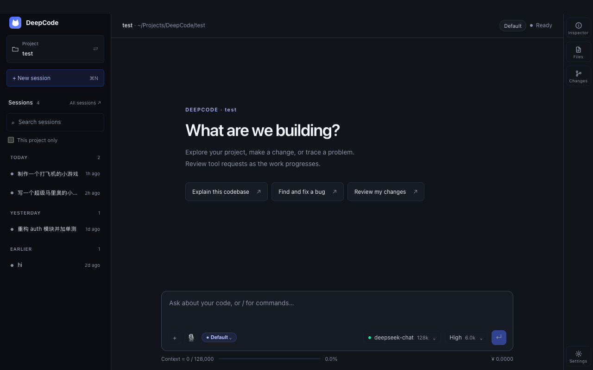
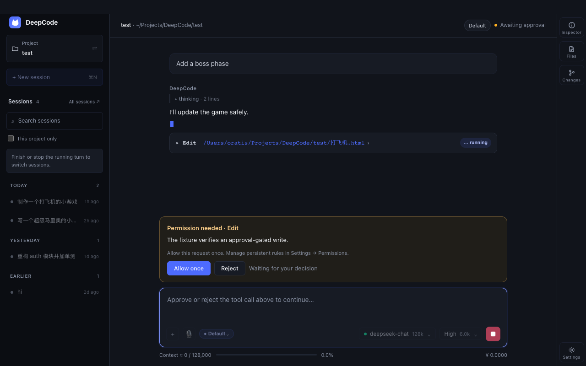

# DeepCode 界面对齐实施进度

> 日期：2026-11-17（Asia/Shanghai）。本轮是现有桌面与编辑器功能的界面改进，**不是 H10/H11 或完整 Harness 化验收**。
> 权威路线：[Harness 改造方案](HARNESS_TRANSFORMATION_PLAN.md)、[Runtime v2 契约](design/harness-runtime-v2.md)、[Harness 实施进度](HARNESS_IMPLEMENTATION_PROGRESS.md)。

## 范围与依据

本轮拥有 `apps/desktop/src`、桌面 UI 测试、`apps/vscode` 展示层和本专项文档。保留 DeepCode 品牌、Tauri、现有协议和用户数据；未修改 core runtime/sessions、kernel、server、CLI bootstrap、锁文件或另一个工作流负责的 Harness 进度文档，未提交或切换分支。

核对了固定版本 `deepseek-harness@39163dd30f703a79079e2d2446545cff3c453738` 的本地只读源码与[源码研究](research/deepseek-harness-architecture-2026-11.md)。采用其可验证的组织方式：项目/会话导航、稳定的主时间线、按需工具详情、右侧检查面板，以及 pending interaction 与 running 的不同状态。没有引入上游运行依赖、照搬其 wire/session 格式，或把 UI slots、插件图、Jobs 当成已实现功能。

CLI 的 [render.ts](../apps/cli/src/render.ts) 已有工具目标摘要、输出头尾裁剪、独立 thinking gutter、Write/Edit 审批 diff；REPL 已支持审批和选项/自由文本回答。本轮以这些现有行为作为对齐基线，未改 CLI 命令或呈现。LSP 无独立聊天界面，未作视觉改造。

## 已实施

| 领域         | 可见行为与设计取舍                                                                                                                                                                                                                         | 实现入口                                                                                                                                                                  |
| ------------ | ------------------------------------------------------------------------------------------------------------------------------------------------------------------------------------------------------------------------------------------ | ------------------------------------------------------------------------------------------------------------------------------------------------------------------------- |
| 桌面工作区   | 保留蓝色品牌与三栏；加强项目、会话、主内容、工具详情的层级。空会话提供可编辑的建议提示；800px 窄窗口将检查面板作为可收起覆盖层，避免挤坏输入框                                                                                             | [App](../apps/desktop/src/App.tsx)、[workspace.css](../apps/desktop/src/workspace.css)                                                                                    |
| 会话导航     | 侧栏与 All sessions 使用同一个 host session index；按标题、ID、项目搜索，支持 This project only、日历 Today/Yesterday 分组、当前会话状态、键盘按钮、加载/空/失败/重试。去掉每组前 20 条的隐藏截断                                          | [Sidebar](../apps/desktop/src/components/Sidebar.tsx)、[Sessions](../apps/desktop/src/screens/Sessions.tsx)、[导航 helper](../apps/desktop/src/lib/session-navigation.ts) |
| 会话生命周期 | 访问 Settings/All sessions 时保留聊天组件、草稿与订阅；Back to conversation 返回原视图。恢复失败保留原选择；历史准备成功后才更换 renderer 的发送目标。运行、切换、归档/删除期间锁住冲突操作                                                | [App](../apps/desktop/src/App.tsx)、[protocol-agent](../apps/desktop/src/lib/protocol-agent.ts)、[window-shim](../apps/desktop/src/lib/window-shim.ts)                    |
| 时间线       | 工具之后的文字显示在后续消息块，实时和恢复顺序一致；结果跨块按 toolId 关联。reasoning 默认折叠且独立于答案；支持安全的标题、段落、平级列表、粗体与代码围栏，未闭合代码可流式显示                                                           | [stream projection](../apps/desktop/src/lib/repl-stream.ts)、[MessageContent](../apps/desktop/src/components/MessageContent.tsx)                                          |
| 工具卡       | 完成卡默认摘要，可键盘展开；失败卡默认展开；长文本显示头尾和省略字符数，可查看已收到的全文。diff 标为 Requested change，并同时显示实际 Result；结果缺失标 result unavailable/interrupted，不伪造成功或永久 running                         | [ToolCard](../apps/desktop/src/components/ToolCard.tsx)、[ToolBody](../apps/desktop/src/components/ToolBody.tsx)                                                          |
| 运行状态     | Ready → Starting/Working → Awaiting approval/input → Completed/Interrupted/Failed。移除无连接证据的固定 connected 标签。Stop/⌘. 先进入 Cancelling，只有 host 终态才解锁；停止失败显示错误并允许重试                                        | [Repl](../apps/desktop/src/screens/Repl.tsx)                                                                                                                              |
| 审批与问题   | 审批固定在输入区上方，显示工具名、原因与单次授权范围。请求无对应卡片时也可操作；发送失败保留请求。问题支持多选和自由文本；取消后禁用回答/授权。输入法组合中的 Enter 不发送                                                                 | [Repl](../apps/desktop/src/screens/Repl.tsx)                                                                                                                              |
| 输入与阅读   | 滚动离开底部后不抢夺位置，显示 Latest activity；输入区显示当前 mode/model/effort。移除未实现的 Memory note 动作与旧版本承诺；Context 标为近似值，未假称实际 checkpoint 大小                                                                | [Repl](../apps/desktop/src/screens/Repl.tsx)                                                                                                                              |
| 检查面板     | 最近文件使用原生可键盘操作按钮；rail 传达 pressed 状态；计划状态和上下文 meter 有可访问语义。切换会话后拒绝迟到的旧 diff、旧错误与 apply/revert 后续刷新                                                                                   | [Inspector](../apps/desktop/src/components/InspectorPanel.tsx)、[use-changes](../apps/desktop/src/lib/use-changes.ts)                                                     |
| 设置与插件   | User settings 明确为用户文件；加载失败可重试，JSON 数组/非对象拒绝保存。当前会话保留 composer 选择，新会话加载保存的默认值。插件页移除假的 Install/Installing；使用真实 CLI 指引，区分加载偏好、信任与实际激活，不作虚假 live enabled 声明 | [Settings](../apps/desktop/src/screens/Settings.tsx)、[Plugins](../apps/desktop/src/screens/Plugins.tsx)                                                                  |
| VS Code      | 多行输入、Send/Stop、状态区、逐消息/逐工具展示、可折叠详情、长输出头尾保留、未知结果、跟随滚动与视图重建恢复。使用 VS Code 主题变量，窄至 280px 无页面横向溢出；审批仍在原生 notification/picker 完成                                      | [controller](../apps/vscode/src/chat-panel.ts)、[webview](../apps/vscode/src/chat-html.ts)、[使用说明](../apps/vscode/README.md)                                          |

## 用户操作变化

- 侧栏 **All sessions** 打开完整会话浏览；输入项目名、标题或 ID 搜索，Escape 清空。未知项目的旧记录保留在 All projects，不被冒充为当前项目。
- 在 Settings 或会话浏览页点击 **Back to conversation** 返回草稿和正在运行的会话。运行期间先处理审批或 Stop，待终态后再切换项目/会话。
- **/clear** 与 New session 使用同一重置入口，清除当前选择与检查面板；之后仍可从侧栏重新打开原会话。Changes 的 Apply/Revert 与发送、会话切换共用操作锁；只读 diff 刷新不会阻塞审批或 Stop。
- 工具卡箭头展开详情；失败输出保留末尾诊断，**Show full output** 展示客户端已收到的完整文本。它不是服务器 spill/artifact 下载功能。
- **Allow once** 只处理当前请求。旧按钮曾写着“本会话 always allow”，实际会写全局 permissions.allow；本轮移除该误导动作。持久规则继续通过 **Settings → Permissions** 管理，不在本轮删除既有规则。
- **Stop / ⌘.** 后保持 Cancelling，不能将中断请求的响应当成进程已经停止。失败时可重试；不自动重放可能已产生副作用的工具。
- 插件安装使用 `deepcode plugins install <spec>`；桌面显示已安装信息与配置偏好，实际加载仍受信任和 host 检查约束。

## 安全、迁移与兼容边界

1. renderer 和 VS Code webview 仍是协议客户端，没有新增 provider 调用或凭证访问。新消息格式化只生成 React 元素；HTML、图片和链接语法保持惰性文本。VS Code 使用 nonce CSP 和 textContent，不执行模型返回的 markup。
2. 审批权限仍由既有 host 判定；客户端只显示状态并发送当前 requestId。桌面当前按既有串行 gate 显示一个待交互请求，未声称支持并发审批 owner 队列。
3. host 拒绝 archive/delete 时错误向上传递，**不再因任意请求失败而退回 Tauri 本地 writer**。仅 host 明确缺少该 capability 时保留旧版 fallback；有对抗回归证明 active-writer 拒绝不会触发本地删除。
4. 有 protocol items 的会话直接投影，不强制读取 legacy 文件。旧记录仍只读适配；没有新增数据迁移、原地改写或 writer。Rename 沿用 `sessionSetTitle` 调用；收尾时并行 H04 已在该 adapter 接入 capability-gated `thread/rename` 与 `session/snapshots`。本轮保留这些改动，host 端新路径的验收归 H04，不计入本轮新增能力。
5. terminal 只代表 UI 收到了 host 终态。浏览器 fixture 不证明真实 provider/进程组停止、OS 沙箱隔离、journal durability 或后台资源回收；这些由相应 runtime 工作包验收。
6. 本轮是呈现层改进，没有切换架构 backend，无需新增架构 ADR。回滚可恢复本轮 UI 组件/样式/展示 adapter，用户会话与凭证无需迁回；不得以视觉回滚为由恢复错误后的本地 writer 绕过。与 H03/H04 并行的文件必须按本轮范围逐项回滚，不能重置整个 checkout。

## 可见证据

以下为实际浏览器渲染截图，已人工目检文字层级、边界、可见动作和窄窗口行为。桌面使用真实 React 组件与 protocol adapter、Tauri 官方 mock IPC；VS Code 使用实际 webview HTML 与模拟 VS Code bridge。它们不是原生 Tauri 安装器或 VS Code Extension Host E2E。





附加截图：[800px Inspector](images/ui-alignment-2026-11-17/desktop-narrow-inspector.png)、[VS Code 工具详情](images/ui-alignment-2026-11-17/vscode-working.png)、[280px VS Code 审批](images/ui-alignment-2026-11-17/vscode-narrow-approval.png)。

## 验证记录

环境：macOS arm64，Node **22.23.4**，pnpm **9.12.0**；本机已安装 Chrome。Playwright 默认 Chromium revision 在本机未安装，使用 `PLAYWRIGHT_CHANNEL=chrome`，未把缺浏览器时的启动失败当成测试通过。CI 默认仍使用 Playwright Chromium。

| 门禁                                  | 结果                                                                                                                                                              |
| ------------------------------------- | ----------------------------------------------------------------------------------------------------------------------------------------------------------------- |
| 全仓库 `pnpm typecheck` / `pnpm lint` | H04 汇合后重新验证通过；早期并行改造期间的 TypeScript lib 不兼容已由主 chat 修复                                                                                  |
| Desktop 单元/投影/adapter 回归        | **155 passed / 14 files**；包括顺序、未知结果、注入文本、日历导航、配置校验、迟到 diff、session owner 错误与 H04 adapter 汇合回归                                 |
| Desktop browser E2E                   | **22 passed**：原有恢复/审批/文件/diff/review/诊断/slash，加草稿保留、恢复失败、取消等待、失败重试、多选/自由文本、长输出、设置错误、窄窗口及下述独立审查竞态回归 |
| VS Code tests                         | **38 passed / 6 files**，含取消竞态、生命周期、断连与损坏协议流清理、重连、跨轮工具配对、视图恢复、长输出尾部                                                     |
| VS Code browser smoke                 | 通过：真实 HTML 的 Enter/Shift+Enter、Send/Stop/Cancelling/Interrupted/Disconnected、跨轮重复工具 ID、详情展开、恶意文本不执行、280px 布局                        |
| Desktop production build              | 通过：`tsc -b && vite build`；未手工编辑 dist 产物                                                                                                                |
| VS Code production build              | 通过；extension **54,943 bytes**，小于既有 64 KiB 预算                                                                                                            |
| 格式、docs:check、diff check          | 全仓库 format:check、docs:check、本地链接、diff check 通过                                                                                                        |

可复现命令（需已安装仓库依赖及 Node22/pnpm9）：

```bash
pnpm typecheck
pnpm lint
pnpm --filter @deepcode/desktop test
pnpm --dir apps/vscode test
PLAYWRIGHT_CHANNEL=chrome pnpm --filter @deepcode/desktop exec playwright test
PLAYWRIGHT_CHANNEL=chrome node --experimental-strip-types apps/vscode/scripts/check-chat-ui.mjs
pnpm --filter @deepcode/desktop build
pnpm --dir apps/vscode build
pnpm docs:check
git diff --check
```

有 Playwright Chromium 时可省略 `PLAYWRIGHT_CHANNEL`。桌面测试启动本地 Vite 预览；浏览器启动/回环监听需要外层环境许可。VS Code smoke 复用 desktop 已有 Playwright 依赖，输出目录可由 `UI_EVIDENCE_DIR` 指定。测试用 IPC 只在 dev preview 中注册，不进入生产构建入口。

本轮未改 Rust，未重跑 cargo；未运行真实模型请求、原生安装/签名、系统屏幕阅读器或多平台 UI 验收。不把相关旧工作流的测试数字挪作本轮证据。

## 剩余项与所需契约

| 后续领域                   | 需要的公共事实与验收；本轮未宣称完成                                                                                                                                                           |
| -------------------------- | ---------------------------------------------------------------------------------------------------------------------------------------------------------------------------------------------- |
| Runtime inspector / 插件图 | effective profile、graph generation、插件来源/版本/诊断/生效代际；需要能力协商和可信展示 DTO，不能仅展示配置文件后声称 live                                                                    |
| Composer 能力驱动          | engine/provider 有效模型、effort、附件、下一安全边界输入能力；当前静态 catalog 不代表 backend/plugin graph 的实时能力                                                                          |
| Jobs / Agents / task 导航  | 持久 job/session owner、父子关系、停止/重附着与恢复状态；现有 Inspector Plan 只是 TodoWrite 投影，未冒充后台任务系统                                                                           |
| Context inspector          | checkpoint、有效请求范围、预算/压缩/剪枝事实；当前 latest usage 近似条不是可重建上下文视图                                                                                                     |
| 交互与连接                 | requestId → callId/owner/deadline/epoch、并发交互队列、cursor/gap/replay 与桌面 transport disconnect 状态仍需契约。VS Code 已接通 owned stdio 断连与用户主动重连，不声称完整事件补偿或自动重放 |
| Session management         | 并行 H04 已开始提供 host rename/snapshots，仍需跟随其契约验收；后续还需列表分页/全局搜索、canonical cwd、legacy/v2 provenance。当前搜索范围为 host 返回的 index，renderer 不做路径 realpath    |
| 插件安装/激活与 UI slots   | install/inspect/activate/rollback 事务、实际激活状态、typed slots 和受限 contribution；第三方 UI-JS 隔离仍属于后续设计                                                                         |
| 大输出与媒体               | artifact/spill 的按需取回/授权；当前只展开客户端收到的文本，不声称完整远端输出                                                                                                                 |
| VS Code 消息能力           | reasoning 独立视图、完整 Markdown、历史 browser 和按 item 粒度的混合 streamed/non-streamed fallback；现有 controller 的 fallback 仍按 turn 判断是否收到过流式文字                              |
| 后续视觉验收               | 原生 Tauri/WebKit、VS Code host、更多窄窗口/系统缩放、完整键盘焦点流程、屏幕阅读器、主题与语言切换；此次 Chrome 截图不是上述环境的替代                                                         |

这些契约待 H03/H04 及后续 H10/H11 推进后逐项接入。现有 About/config diagnostics 的来源与 trust 信息继续可用；没有通过新建不可用的 Runtime、Jobs 或 Marketplace 页面掩盖缺失能力。

## H03/H04 汇合复核（2026-11-17）

主 chat 已修复并行 TypeScript lib 错误并完成全仓 typecheck、lint、format:check 和 release:check。H04 的 journal rename/snapshot 能力及桌面数据 adapter 已接通，带协议与资源校验测试。会话列表连接或 journal 错误现在向 UI 报告；仅旧 sidecar 明确缺能力时才读取旧索引，避免隐藏 v2 错误。完整测试结果见 [Harness 实施进度](HARNESS_IMPLEMENTATION_PROGRESS.md)。上表更新为 UI 独立审查后的本地验证记录；最终统一发布门禁由主 chat 执行。

## 发布前独立审查（2026-11-17）

两位未参与实现的 agent 分别只读审查 Desktop 与 VS Code，并提供可复现的 P2 问题；修复由实现方完成，再交原 reviewer 复查。

| 问题                                | 修复及回归                                                                                                                                                              |
| ----------------------------------- | ----------------------------------------------------------------------------------------------------------------------------------------------------------------------- |
| `/clear` 只清聊天，父层仍选中旧会话 | 委托 App 的统一 reset；浏览器验证原会话可再次恢复                                                                                                                       |
| Changes Apply/Revert 绕过导航锁     | 发送、会话切换与 review 使用同步门禁；启动成功到 `turn_started` 连续持锁，失败可重试；独立 diff 刷新不阻塞交互，request token 防止旧请求解锁新请求                      |
| 审批响应与下一问题到达顺序竞态      | 新请求替换旧类型面板；响应处理与 busy 清理按 requestId 归属，测试两个方向及旧响应迟到                                                                                   |
| Stop 失败丢弃期间到达的交互         | Cancelling 期间保存并禁用请求，失败后恢复可操作；审批、提问均有浏览器回归                                                                                               |
| VS Code 断连后永远保留 active       | extension host 监听真实连接断开，清理旧路由并标记结果未知；下一次用户发送才重连、恢复 canonical thread，由 host 判定新 turn。普通 Stop 请求失败仍保持运行锁，不自动重放 |
| 跨轮重复工具 ID 覆盖历史卡片        | 使用 `[turnId, itemId]` 复合键，覆盖实时结果、未知结果与视图回放；单元与真实 HTML smoke 验证两轮卡片独立                                                                |

复查还覆盖了两个同边界问题：Desktop 的慢 diff 读取不得延长 review 启动锁；VS Code 遇损坏协议帧须先关闭 owned transport，清理失败时禁止创建第二个连接 owner。两者均已修复并增加回归。

两位独立 reviewer 已复验关闭本次提出的全部阻塞，审查范围内无剩余 P1/P2。本 chat 不执行 commit、PR、merge 或 tag，用户已指定原 H03/H04 chat 统一发布。

### v0.5.1 传输层修复

v0.5.0 发布后对正式 VSIX 的扩展验收发现，部分已声明会话方法被 stdio decoder 的旧白名单拒绝。v0.5.1 在 protocol 层补齐全部声明方法，并增加真实 stdio 与 bundle 操作验收；界面使用既有协议接口，无需另增客户端 fallback。请安装 v0.5.1 或更新版本，详见 [发布后修复记录](HARNESS_IMPLEMENTATION_PROGRESS.md#v051-发布后修复)。
